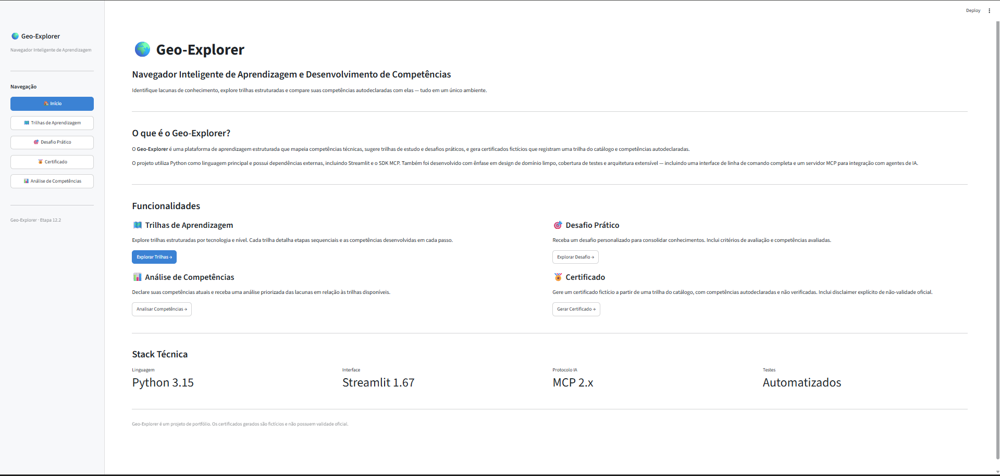
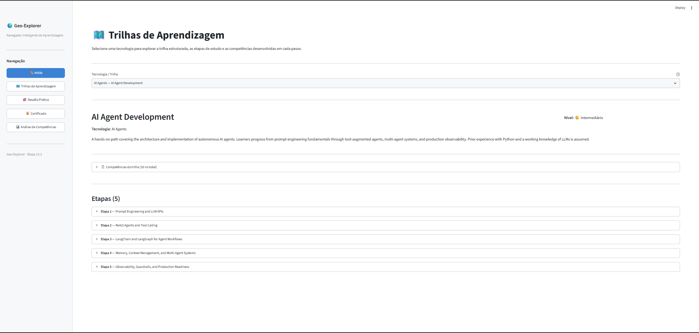
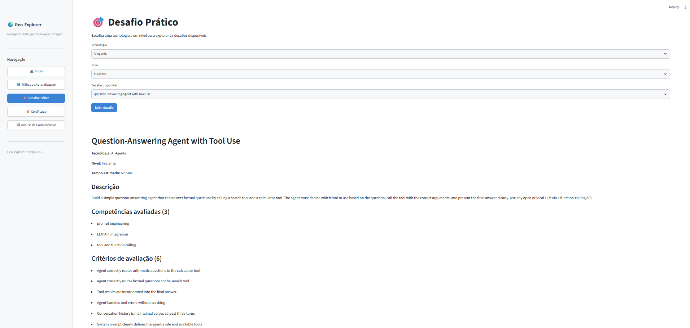
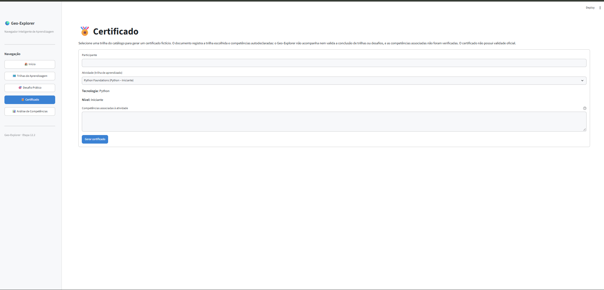
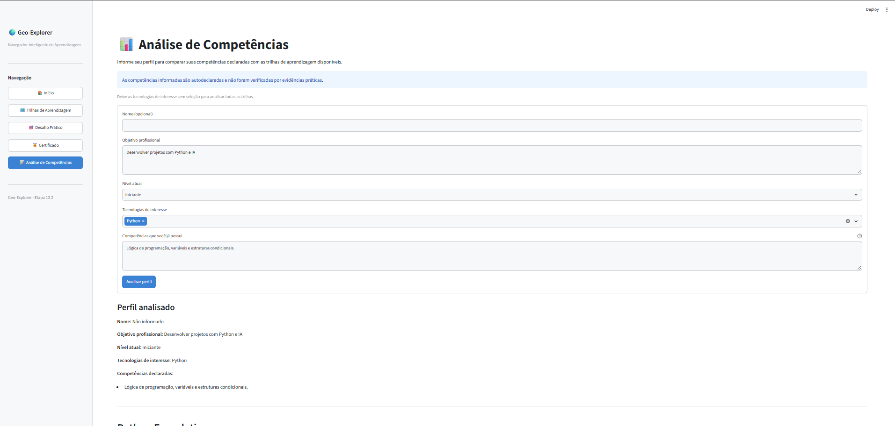

# Geo-Explorer

Aplicação Python para explorar trilhas de aprendizagem, desafios práticos e
lacunas de competências por meio de interfaces Streamlit, CLI e MCP.

## Objetivo e público-alvo

O Geo-Explorer organiza catálogos locais de trilhas e desafios e compara as
competências informadas por uma pessoa com as competências descritas nesses
catálogos. É voltado a pessoas em aprendizagem autodirigida e a quem deseja
explorar ou estudar um projeto Python com interfaces gráfica, de linha de
comando e de integração MCP.

O projeto expõe funcionalidades por ferramentas MCP para clientes
compatíveis. Ele **não executa agentes de IA nem modelos de IA**.

## Funcionalidades implementadas

- **Trilhas de aprendizagem:** consulta trilhas por tecnologia, com nível,
  descrição, competências e etapas ordenadas.
- **Desafios práticos:** filtra desafios por tecnologia e nível. A CLI e a
  ferramenta MCP escolhem um desafio compatível; na interface gráfica, a
  pessoa seleciona um dos desafios disponíveis.
- **Análise de competências:** compara as competências informadas com as
  trilhas, apresenta índice de cobertura declarada, lacunas e recomendações
  priorizadas.
- **Certificados fictícios:** gera um registro com participante, atividade,
  tecnologia, nível, competências, data e identificador.
- **Interface Streamlit:** disponibiliza páginas para Home, Trilhas, Desafio
  Prático, Certificado e Análise de Competências.
- **Interface CLI:** apresenta um menu interativo para consultar trilhas,
  gerar desafios e certificados fictícios e analisar competências.
- **Servidor MCP:** disponibiliza quatro ferramentas:
  `get_learning_path`, `get_challenge`, `generate_certificate` e
  `analyze_competencies`.

## Evidências da aplicação


*Página inicial.*


*Consulta de trilhas de aprendizagem.*


*Seleção e exibição de um desafio prático.*


*Formulário e resultado do certificado fictício.*


*Análise de competências e recomendações.*

## Tecnologias e dependências

- Python
- Streamlit, para a interface gráfica.
- MCP Python SDK, para expor as ferramentas por Model Context Protocol.
- pytest, para os testes.
- JSON local, para os catálogos.

As dependências declaradas em [requirements.txt](requirements.txt) usam faixas
de versão, não versões exatas:

```text
mcp>=2,<3
streamlit>=1.67,<2
pytest>=8.0
```

O repositório não declara uma versão mínima ou uma faixa de suporte do Python.
Essa compatibilidade deve ser confirmada antes de publicar uma recomendação de
versão.

## Instalação no Windows PowerShell

Execute os comandos na raiz do projeto:

```powershell
python -m venv .venv
.\.venv\Scripts\Activate.ps1
python -m pip install -r requirements.txt
```

## Como executar

### Interface Streamlit

```powershell
python -m streamlit run gui\app.py
```

### Interface CLI

```powershell
python main.py
```

O menu interativo permite escolher entre consultar uma trilha, gerar um
desafio, gerar um certificado fictício, analisar competências ou sair.

### Servidor MCP

```powershell
python -m mcp_server.server
```

O servidor utiliza transporte **stdio** e deve ser iniciado por um cliente
MCP compatível, no ambiente em que as dependências do projeto estejam
instaladas. As quatro ferramentas registradas são:

| Ferramenta | Finalidade |
|---|---|
| `get_learning_path` | Consultar uma trilha pela tecnologia. |
| `get_challenge` | Escolher um desafio por tecnologia e nível. |
| `generate_certificate` | Gerar os dados de um certificado fictício. |
| `analyze_competencies` | Analisar competências e retornar lacunas e recomendações. |

O servidor não disponibiliza transporte HTTP nem recursos MCP no código
atual.

## Testes

Para executar a suíte completa:

```powershell
python -m pytest tests -q
```

Os testes cobrem modelos, carregamento e validação dos dados, análise de
competências, comandos, ferramentas MCP e fluxos da interface Streamlit.
Os testes de GUI usam `AppTest`; os testes de protocolo MCP usam um cliente
em processo e não iniciam o transporte stdio.

## Dados

Os catálogos são **locais, estáticos e fornecidos com o projeto**. Não há
integração com a DIO nem consulta a serviços externos para obter trilhas ou
desafios durante os fluxos implementados.

- [data/learning_paths.json](data/learning_paths.json): lista de trilhas com
  identificador, título, tecnologia, nível, descrição, competências e etapas.
  Cada etapa inclui ordem, descrição e competências desenvolvidas.
- [data/challenges.json](data/challenges.json): lista de desafios com
  identificador, título, tecnologia, nível, descrição, critérios de avaliação,
  competências avaliadas e tempo estimado.

Os carregadores leem os arquivos em UTF-8 e constroem os modelos usados pela
aplicação. O catálogo atual contém quatro trilhas (Python, Artificial
Intelligence, AI Agents e n8n) e 13 desafios. Referências a serviços ou
bibliotecas dentro da descrição de um desafio são requisitos daquele exercício,
não integrações incluídas no Geo-Explorer.

## Estrutura do projeto

```text
geo-explorer/
├── .streamlit/
│   └── config.toml
├── commands/
│   ├── __init__.py
│   ├── analise.py
│   ├── certificado.py
│   ├── desafio.py
│   └── trilha.py
├── core/
│   ├── __init__.py
│   ├── competency_analyzer.py
│   ├── data_loader.py
│   └── models.py
├── data/
│   ├── .gitkeep
│   ├── challenges.json
│   └── learning_paths.json
├── docs/
│   ├── .gitkeep
│   ├── architecture.md
│   ├── examples.md
│   ├── index.md
│   ├── mcp.md
│   ├── testing.md
│   └── assets/
│       ├── 01-home.png
│       ├── 02-trilhas.png
│       ├── 03-desafio.png
│       ├── 04-certificado.png
│       └── 05-analise.png
├── gui/
│   ├── __init__.py
│   ├── app.py
│   ├── components/
│   │   ├── __init__.py
│   │   └── sidebar.py
│   └── pages/
│       ├── __init__.py
│       ├── analise.py
│       ├── certificado.py
│       ├── desafio.py
│       ├── home.py
│       └── trilhas.py
├── mcp_server/
│   ├── __init__.py
│   ├── formatters.py
│   ├── server.py
│   └── tools/
│       ├── __init__.py
│       ├── analise.py
│       ├── certificado.py
│       ├── desafio.py
│       └── trilha.py
├── tests/
│   ├── __init__.py
│   ├── test_analise.py
│   ├── test_certificado.py
│   ├── test_competency_analyzer.py
│   ├── test_data_loader.py
│   ├── test_desafio.py
│   ├── test_gui_analise.py
│   ├── test_gui_certificado.py
│   ├── test_gui_desafio.py
│   ├── test_gui_home.py
│   ├── test_gui_trilhas.py
│   ├── test_main.py
│   ├── test_mcp_tools.py
│   └── test_trilha.py
├── .gitignore
├── README.md
├── main.py
└── requirements.txt
```

- `core/`: modelos de domínio, carregamento das trilhas e análise de
  competências.
- `commands/`: operações e apresentação da CLI; inclui carregamento e filtro
  de desafios.
- `gui/`: entrada Streamlit, navegação lateral e páginas.
- `mcp_server/`: inicialização do servidor stdio, ferramentas MCP e
  formatação de resultados.
- `data/`: catálogos JSON locais.
- `tests/`: testes de unidade, integração em processo e interface.
- `docs/`: índice e documentação técnica de arquitetura, MCP, exemplos e
  testes.

## Documentação técnica

A documentação técnica está disponível:

- [Índice da documentação](docs/index.md) — visão geral e mapa dos
  documentos.
- [Arquitetura](docs/architecture.md) — camadas, responsabilidades e fluxos
  das interfaces.
- [Integração MCP](docs/mcp.md) — transporte stdio, ferramentas, parâmetros
  e limitações.
- [Exemplos práticos](docs/examples.md) — exemplos das interfaces e
  ferramentas com dados dos catálogos atuais.
- [Testes](docs/testing.md) — organização, execução, cobertura observada e
  limites dos testes.

## Quais melhorias foram realizadas

O Geo-Explorer foi ampliado para além da consulta de trilhas, incorporando
análise de competências, interface gráfica, ferramentas MCP para clientes
compatíveis e testes automatizados. Os dados utilizados vêm de catálogos JSON
locais.

As principais melhorias realizadas foram:

- **Arquitetura organizada em módulos:** estruturação do projeto em diretórios
  com responsabilidades específicas, com o objetivo de facilitar a manutenção
  e a evolução do código.
- **Ampliação do catálogo de aprendizagem:** organização de quatro trilhas — Python, Inteligência Artificial, Agentes de IA e automação com n8n — cada uma com cinco etapas e competências associadas.
- **Criação de desafios práticos:** inclusão de 13 desafios com diferentes tecnologias e níveis de dificuldade, acompanhados de critérios de avaliação, competências trabalhadas e estimativa de duração.
- **Análise de competências:** implementação de uma funcionalidade que compara competências autodeclaradas pelo usuário com as competências previstas nas trilhas, identificando correspondências, lacunas e recomendações.
- **Recomendações priorizadas:** apresentação de sugestões de aprendizagem com prioridades, justificativas e indicação de alvos relacionados às competências que precisam ser desenvolvidas.
- **Interface gráfica com Streamlit:** criação de cinco páginas para tornar as funcionalidades acessíveis sem depender exclusivamente do terminal.
- **Navegação personalizada:** implementação de navegação lateral entre as páginas e integração dos atalhos da página inicial.
- **Integração MCP:** disponibilização de quatro ferramentas por meio do Model Context Protocol (MCP), permitindo consultar trilhas, obter desafios, gerar certificados demonstrativos e analisar competências.
- **Tratamento de erros e situações excepcionais:** melhorias para lidar com dados ausentes, listas vazias, entradas inválidas e falhas no carregamento de arquivos.
- **Testes automatizados ampliados:** criação de testes para os módulos principais, interface gráfica, navegação, formulários, estados da aplicação e ferramentas MCP.
- **Documentação e evidências:** organização de instruções de instalação, execução, testes, exemplos de uso e capturas de tela da aplicação.

A suíte de testes chegou a **512 testes aprovados e 53 subtestes aprovados em 7,17 s**, demonstrando a ampliação dos cenários validados ao longo do desenvolvimento.

O projeto também passou a oferecer três formas de interação: CLI, interface gráfica e ferramentas MCP.

**Observação sobre os resultados:** a análise utiliza competências informadas pelo próprio usuário. Ela não realiza avaliação prática automática nem comprova domínio profissional. Os certificados são demonstrativos e não possuem validade oficial.

## O que foi aprendido durante o desafio

Como reflexão pessoal, o desenvolvimento do Geo-Explorer me proporcionou
experiência prática em programação Python, organização de projetos, integração
entre componentes, testes automatizados e construção de aplicações com
diferentes interfaces.

Entre os aprendizados que o desafio me proporcionou, destaco:

- **Arquitetura de software:** compreender a importância de organizar o código em módulos, definir responsabilidades e reduzir dependências desnecessárias entre componentes.
- **Programação orientada a objetos:** trabalhar com classes, dataclasses, tipagem, atributos, métodos e valores padrão seguros.
- **Manipulação e validação de JSON:** estruturar bases de dados, carregar informações, validar campos obrigatórios e tratar dados inválidos.
- **Desenvolvimento com Python:** aplicar funções, enums, tratamento de exceções, organização de pacotes e execução de módulos.
- **Testes automatizados com pytest:** criar testes unitários e integrados, validar cenários positivos e negativos, identificar falhas e corrigir comportamentos inesperados.
- **Testes de interface com Streamlit AppTest:** verificar elementos e interações da aplicação, como formulários, navegação, estados e situações de erro; não substituem uma revisão visual completa em navegador real.
- **Desenvolvimento de interfaces gráficas:** utilizar Streamlit para transformar funcionalidades de terminal em uma aplicação com páginas, formulários, seletores e navegação.
- **Protocolo MCP:** compreender como disponibilizar funcionalidades como
  ferramentas por meio do Model Context Protocol e como o servidor implementa
  o transporte STDIO; os testes em processo não comprovam interoperabilidade
  com um cliente externo.
- **Análise de competências:** aplicar lógica de comparação, identificação de lacunas e geração de recomendações com base em dados estruturados.
- **Git e GitHub:** organizar o repositório, acompanhar alterações, trabalhar com arquivos rastreados e não rastreados e publicar o projeto.
- **Auditoria e manutenção de código:** inspecionar implementações existentes, avaliar impactos das alterações, planejar correções e validar os resultados antes de avançar.
- **Continuidade do desenvolvimento em diferentes ambientes:** adaptar o fluxo de trabalho após a transição do IBM Bob para o Visual Studio Code, mantendo o projeto localmente e utilizando o GitHub Copilot como apoio à análise e às correções.
- **Documentação técnica:** registrar decisões, instruções de execução, limitações conhecidas, resultados de testes e evidências do funcionamento.

### Aprendizado principal

O maior aprendizado foi compreender que desenvolver uma aplicação não significa apenas fazer uma funcionalidade funcionar. Também é necessário estruturar o código, validar os dados, testar diferentes cenários, documentar decisões e considerar como cada componente será utilizado e mantido.

O Geo-Explorer permitiu aplicar esses conhecimentos em um projeto integrado, evoluindo de uma aplicação de linha de comando para uma solução com interface gráfica e ferramentas MCP.

## Histórico e Processo de Desenvolvimento

Segundo o histórico de desenvolvimento registrado para o projeto, o trabalho
começou com apoio do IBM Bob e teve continuidade local no Visual Studio Code,
com apoio do GitHub Copilot.

### 1. Fase inicial

O histórico registrado para o projeto associa a fase inicial ao apoio do IBM
Bob e a atividades de concepção da arquitetura, implementação das
funcionalidades principais e validação dos componentes.

Entre as principais atividades realizadas nessa fase, destacam-se:

- **Estruturação da arquitetura:** organização do projeto em camadas, separando `core/`, `commands/`, `mcp_server/`, `data/`, `tests/` e `docs/`.
- **Modelagem de dados:** criação dos modelos `LearningPath`, `LearnerProfile`, `Challenge`, `Recommendation` e `LearningStep`, com tipagem e valores padrão seguros.
- **Base de aprendizagem:** estruturação e refinamento de quatro trilhas de aprendizagem, contemplando Python, Inteligência Artificial, Agentes de IA e automação com n8n.
- **Carregamento e validação de dados:** implementação do carregador de trilhas e tratamento de erros relacionados a arquivos e estruturas JSON.
- **Desafios práticos:** criação de 13 desafios, distribuídos entre tecnologias e níveis de dificuldade.
- **Comandos de linha de comando (CLI):** implementação das funcionalidades de consulta de trilhas, geração de desafios, análise de competências e emissão de certificados fictícios.
- **Análise de competências:** desenvolvimento da lógica de comparação entre competências declaradas e competências das trilhas, com identificação de lacunas e recomendações.
- **Servidor MCP:** integração das funcionalidades por meio de quatro ferramentas, utilizando transporte STDIO.
- **Testes automatizados:** desenvolvimento de testes unitários e validações integradas para os componentes principais.

O histórico de desenvolvimento registra 246 testes aprovados ao final da fase
inicial e 326 após uma expansão posterior; esses marcos não foram reproduzidos
nesta auditoria.

O histórico do projeto registra que a etapa 12.1 iniciou a interface gráfica com Streamlit, criando a estrutura inicial da aplicação e preparando o ambiente para a implementação das páginas.

### 2. Transição para o Visual Studio Code

O histórico registrado para o projeto relata que, após o encerramento da cota
de créditos do IBM Bob, a continuidade ocorreu localmente no Visual Studio
Code.

A migração foi realizada preservando a estrutura existente do projeto, os módulos Python, os dados JSON e os testes já desenvolvidos.

O mesmo histórico registra o GitHub Copilot como apoio à inspeção do código,
à auditoria técnica, às correções e à implementação das funcionalidades
seguintes.

O histórico descreve o trabalho como incremental: os arquivos eram
inspecionados, as alterações planejadas e, após aprovação, implementadas e
validadas.

### 3. Finalização da interface gráfica — etapas 12.2 a 12.6

No Visual Studio Code, a interface gráfica foi ampliada e finalizada com cinco páginas:

- **Home:** apresentação do projeto e acesso às funcionalidades.
- **Trilhas:** consulta das trilhas, etapas e competências.
- **Desafio Prático:** seleção e apresentação de desafios por tecnologia e nível.
- **Certificado:** geração de registros fictícios da trilha selecionada e das competências associadas, sem validade oficial.
- **Análise de Competências:** comparação das competências autodeclaradas com as trilhas e apresentação de lacunas e recomendações priorizadas.

As páginas da interface reutilizam funções do núcleo e dos comandos.

Também foram desenvolvidas as seguintes melhorias:

- Integração das páginas à navegação personalizada do Streamlit.
- Armazenamento temporário de resultados por meio de `st.session_state`.
- Tratamento de listas vazias e erros de carregamento.
- Aviso explícito de que as competências informadas são autodeclaradas e não representam comprovação prática.
- Correção da navegação duplicada causada pela descoberta automática de páginas do Streamlit.
- Ampliação dos testes automatizados para validar conteúdo, navegação, formulários, estados e situações de erro.

### 4. Auditoria, testes e validação

O histórico de desenvolvimento registra auditorias e execuções sucessivas dos testes automatizados.

Os valores abaixo são marcos registrados no histórico do projeto e não foram reproduzidos nesta auditoria:

| Marco | Testes aprovados |
|---|---:|
| Conclusão da fase inicial de CLI e MCP | 246 |
| Expansão da análise de competências | 326 |
| Estrutura inicial da interface gráfica | 416 |
| Implementação das páginas Desafio e Certificado | 423 |
| Implementação da página Análise de Competências | 426 |
| Etapa 12.6 — Ampliação dos testes da GUI e correção da navegação | 450 |

O resultado mais recente registrado foi de **512 testes aprovados e 53 subtestes aprovados em 7,17 s**.

Os testes automatizados incluem testes de funções de comandos, testes de
interface com AppTest e chamadas das ferramentas MCP em processo. Eles não
demonstram validação ponta a ponta de todos os fluxos: o AppTest não substitui
uma revisão visual completa em navegador real, e os testes MCP em processo não
comprovam interoperabilidade com um cliente externo via STDIO. Não foi medido
percentual de cobertura de código.

### 5. Resultado do processo

O processo de desenvolvimento permitiu transformar uma estrutura inicialmente organizada em módulos Python em uma aplicação com diferentes formas de interação:

- Interface de linha de comando (CLI).
- Interface gráfica com Streamlit.
- Ferramentas integradas pelo protocolo MCP.

A transição entre ferramentas de desenvolvimento também proporcionou experiência prática com manutenção de código existente, auditoria técnica, testes automatizados, integração entre módulos e continuidade de projetos em ambiente local.

O resultado é um projeto organizado em módulos, com funcionalidades reutilizáveis, documentação, dados organizados e testes automatizados para apoiar sua manutenção e evolução.

## Limitações e avisos

- As competências usadas na análise são **autodeclaradas** e **não são
  verificadas por evidências práticas**. O índice de cobertura não comprova
  domínio ou proficiência. A comparação considera igualdade dos nomes após
  remover espaços externos e ignorar maiúsculas e minúsculas; não interpreta
  linguagem natural, sinônimos, paráfrases ou correspondências parciais. A
  tecnologia selecionada filtra as trilhas, mas não preenche as competências
  do perfil. Para obter correspondências, use os nomes completos do catálogo,
  como `Python syntax and semantics`; entradas como `Python` ou
  `programação Python` podem resultar em zero correspondências.
- Os certificados são **fictícios, sem validade oficial e sem exportação**.
  O Geo-Explorer **não acompanha o progresso** nem valida a conclusão de
  trilhas ou desafios. O registro pode listar competências informadas pela
  pessoa ou, se o campo ficar vazio, competências provenientes do catálogo.
  Essas informações não comprovam domínio, conclusão ou participação.
- O perfil e a análise da interface Streamlit ficam na sessão; não há banco de
  dados nem persistência de perfil entre sessões.
- Os dados são catálogos locais e estáticos. Não há edição de catálogo pela
  interface.
- Os desafios são descrições de exercícios; a aplicação não executa nem avalia
  automaticamente as soluções.
- O MCP utiliza stdio. Não há endpoint HTTP implementado.
- O repositório não contém arquivo de licença. Consulte os responsáveis pelo
  projeto antes de reutilizar ou redistribuir o código.
