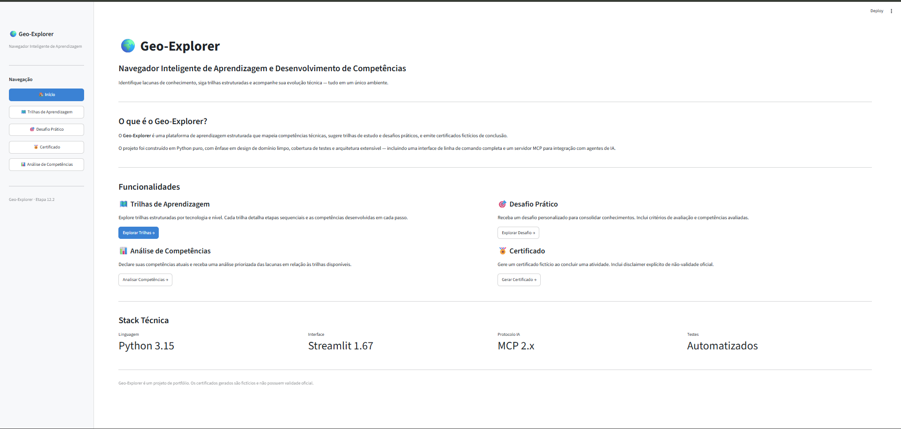
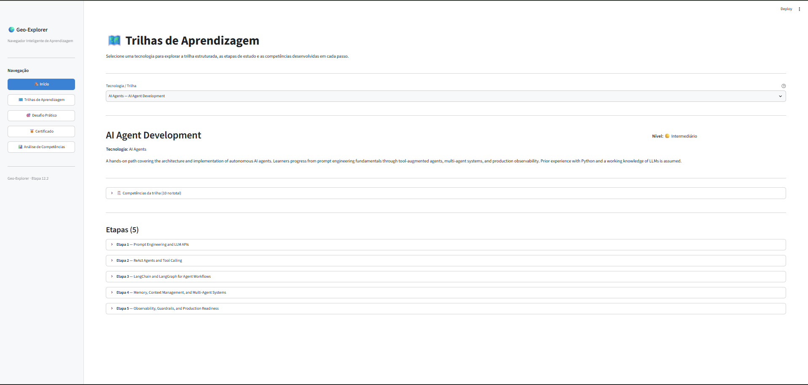
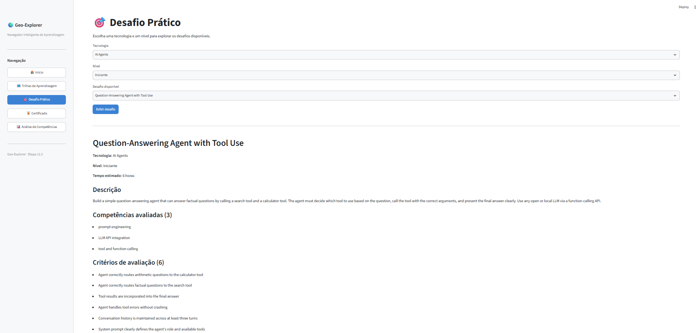
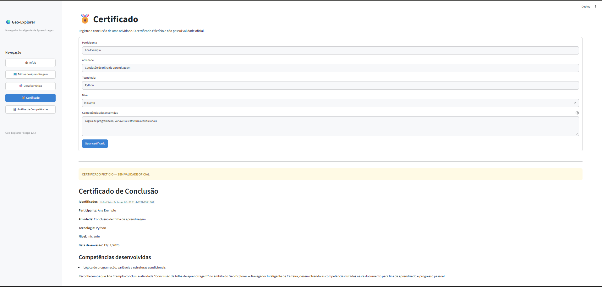
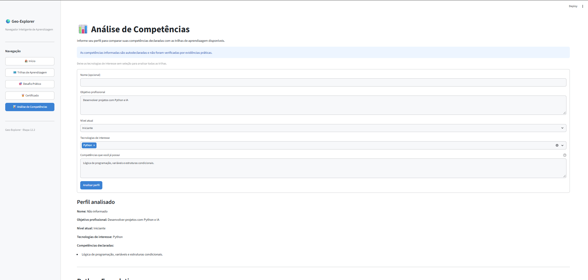

# Geo-Explorer

Aplicação Python para explorar trilhas de aprendizagem, desafios práticos e
lacunas de competências por meio de interfaces Streamlit, CLI e MCP.

## Objetivo e público-alvo

O Geo-Explorer organiza catálogos locais de trilhas e desafios e compara as
competências informadas por uma pessoa com as competências descritas nesses
catálogos. É voltado a pessoas em aprendizagem autodirigida e a quem deseja
explorar ou estudar um projeto Python com interfaces gráfica, de linha de
comando e de integração MCP.

O projeto oferece funções como ferramentas MCP para clientes externos. Ele
**não executa agentes de IA nem modelos de IA**.

## Funcionalidades implementadas

- **Trilhas de aprendizagem:** consulta trilhas por tecnologia, com nível,
  descrição, competências e etapas ordenadas.
- **Desafios práticos:** filtra desafios por tecnologia e nível. A CLI e a
  ferramenta MCP escolhem um desafio compatível; na interface gráfica, a
  pessoa seleciona um dos desafios disponíveis.
- **Análise de competências:** compara as competências informadas com as
  trilhas, apresenta índice de cobertura declarada, lacunas e recomendações
  priorizadas.
- **Certificados fictícios:** gera um registro com participante, atividade,
  tecnologia, nível, competências, data e identificador.
- **Interface Streamlit:** disponibiliza páginas para Home, Trilhas, Desafio
  Prático, Certificado e Análise de Competências.
- **Interface CLI:** apresenta um menu interativo para consultar trilhas,
  gerar desafios e certificados fictícios e analisar competências.
- **Servidor MCP:** disponibiliza quatro ferramentas:
  `get_learning_path`, `get_challenge`, `generate_certificate` e
  `analyze_competencies`.

## Evidências da aplicação


*Página inicial.*


*Consulta de trilhas de aprendizagem.*


*Seleção e exibição de um desafio prático.*


*Formulário e resultado do certificado fictício.*


*Análise de competências e recomendações.*

## Tecnologias e dependências

- Python
- Streamlit, para a interface gráfica.
- MCP Python SDK, para expor as ferramentas por Model Context Protocol.
- pytest, para os testes.
- JSON local, para os catálogos.

As dependências declaradas em [requirements.txt](requirements.txt) usam faixas
de versão, não versões exatas:

```text
mcp>=2,<3
streamlit>=1.67,<2
pytest>=8.0
```

O repositório não declara uma versão mínima ou uma faixa de suporte do Python.
Essa compatibilidade deve ser confirmada antes de publicar uma recomendação de
versão.

## Instalação no Windows PowerShell

Execute os comandos na raiz do projeto:

```powershell
python -m venv .venv
.\.venv\Scripts\Activate.ps1
python -m pip install -r requirements.txt
```

## Como executar

### Interface Streamlit

```powershell
python -m streamlit run gui\app.py
```

### Interface CLI

```powershell
python main.py
```

O menu interativo permite escolher entre consultar uma trilha, gerar um
desafio, gerar um certificado fictício, analisar competências ou sair.

### Servidor MCP

```powershell
python -m mcp_server.server
```

O servidor utiliza transporte **stdio** e deve ser iniciado por um cliente
MCP compatível, no ambiente em que as dependências do projeto estejam
instaladas. As quatro ferramentas registradas são:

| Ferramenta | Finalidade |
|---|---|
| `get_learning_path` | Consultar uma trilha pela tecnologia. |
| `get_challenge` | Escolher um desafio por tecnologia e nível. |
| `generate_certificate` | Gerar os dados de um certificado fictício. |
| `analyze_competencies` | Analisar competências e retornar lacunas e recomendações. |

O servidor não disponibiliza transporte HTTP nem recursos MCP no código
atual.

## Testes

Para executar a suíte completa:

```powershell
python -m pytest -q
```

Os testes cobrem modelos, carregamento e validação dos dados, análise de
competências, comandos, ferramentas MCP e fluxos da interface Streamlit.
Os testes de GUI usam `AppTest`; os testes de protocolo MCP usam um cliente
em processo e não iniciam o transporte stdio.

## Dados

Os catálogos são **locais, estáticos e fornecidos com o projeto**. Não há
integração com a DIO nem consulta a serviços externos para obter trilhas ou
desafios durante os fluxos implementados.

- [data/learning_paths.json](data/learning_paths.json): lista de trilhas com
  identificador, título, tecnologia, nível, descrição, competências e etapas.
  Cada etapa inclui ordem, descrição e competências desenvolvidas.
- [data/challenges.json](data/challenges.json): lista de desafios com
  identificador, título, tecnologia, nível, descrição, critérios de avaliação,
  competências avaliadas e tempo estimado.

Os carregadores leem os arquivos em UTF-8 e constroem os modelos usados pela
aplicação. O catálogo atual contém quatro trilhas (Python, Artificial
Intelligence, AI Agents e n8n) e 13 desafios. Referências a serviços ou
bibliotecas dentro da descrição de um desafio são requisitos daquele exercício,
não integrações incluídas no Geo-Explorer.

## Estrutura do projeto

```text
geo-explorer/
├── .streamlit/
│   └── config.toml
├── commands/
│   ├── __init__.py
│   ├── analise.py
│   ├── certificado.py
│   ├── desafio.py
│   └── trilha.py
├── core/
│   ├── __init__.py
│   ├── competency_analyzer.py
│   ├── data_loader.py
│   └── models.py
├── data/
│   ├── .gitkeep
│   ├── challenges.json
│   └── learning_paths.json
├── docs/
│   ├── .gitkeep
│   ├── architecture.md
│   ├── examples.md
│   ├── index.md
│   ├── mcp.md
│   ├── testing.md
│   └── assets/
│       ├── 01-home.png
│       ├── 02-trilhas.png
│       ├── 03-desafio.png
│       ├── 04-certificado.png
│       └── 05-analise.png
├── gui/
│   ├── __init__.py
│   ├── app.py
│   ├── components/
│   │   ├── __init__.py
│   │   └── sidebar.py
│   └── pages/
│       ├── __init__.py
│       ├── analise.py
│       ├── certificado.py
│       ├── desafio.py
│       ├── home.py
│       └── trilhas.py
├── mcp_server/
│   ├── __init__.py
│   ├── formatters.py
│   ├── server.py
│   └── tools/
│       ├── __init__.py
│       ├── analise.py
│       ├── certificado.py
│       ├── desafio.py
│       └── trilha.py
├── tests/
│   ├── __init__.py
│   ├── test_analise.py
│   ├── test_certificado.py
│   ├── test_competency_analyzer.py
│   ├── test_data_loader.py
│   ├── test_desafio.py
│   ├── test_gui_analise.py
│   ├── test_gui_certificado.py
│   ├── test_gui_desafio.py
│   ├── test_gui_home.py
│   ├── test_gui_trilhas.py
│   ├── test_mcp_tools.py
│   └── test_trilha.py
├── .gitignore
├── README.md
├── main.py
└── requirements.txt
```

- `core/`: modelos de domínio, carregamento das trilhas e análise de
  competências.
- `commands/`: operações e apresentação da CLI; inclui carregamento e filtro
  de desafios.
- `gui/`: entrada Streamlit, navegação lateral e páginas.
- `mcp_server/`: inicialização do servidor stdio, ferramentas MCP e
  formatação de resultados.
- `data/`: catálogos JSON locais.
- `tests/`: testes de unidade, integração em processo e interface.
- `docs/`: índice e documentação técnica de arquitetura, MCP, exemplos e
  testes.

## Documentação técnica

A documentação técnica está disponível:

- [Índice da documentação](docs/index.md) — visão geral e mapa dos
  documentos.
- [Arquitetura](docs/architecture.md) — camadas, responsabilidades e fluxos
  das interfaces.
- [Integração MCP](docs/mcp.md) — transporte stdio, ferramentas, parâmetros
  e limitações.
- [Exemplos práticos](docs/examples.md) — exemplos das interfaces e
  ferramentas com dados dos catálogos atuais.
- [Testes](docs/testing.md) — organização, execução, cobertura observada e
  limites dos testes.

## Quais melhorias foram realizadas

O Geo-Explorer expandiu a proposta original do desafio por meio de melhorias estruturais, arquiteturais e funcionais comprovadas no código e nos testes:

- **Arquitetura em camadas desacopladas:** separação deliberada entre modelos de domínio (`core/models.py`), persistência e carregadores locais (`core/data_loader.py`), comandos e operações (`commands/`), interface web (`gui/`) e servidor de protocolo (`mcp_server/`). Os modelos utilizam dataclasses puras e enumerações, sem dependências externas no núcleo de domínio.
- **Três interfaces de interação funcionais:**
  - *CLI interativa (`main.py`):* menu orientado a texto com navegação guiada, cancelamento de operações e tratamento de entradas inválidas.
  - *Interface gráfica com Streamlit (`gui/app.py`):* painel web estruturado em cinco páginas (`Home`, `Trilhas`, `Desafio Prático`, `Certificado` e `Análise de Competências`), com barra lateral personalizada e formulários responsivos.
  - *Servidor MCP sobre stdio (`mcp_server/server.py`):* integração compatível com a especificação Model Context Protocol, disponibilizando quatro ferramentas prontas para consumo por agentes e clientes externos.
- **Análise de competências e recomendações priorizadas:** motor de regras (`core/competency_analyzer.py`) que confronta competências autodeclaradas com as trilhas disponíveis, calcula percentuais de cobertura, mapeia lacunas e gera recomendações ordenadas por prioridade calculada (escala de 1 a 5).
- **Suíte de 450 testes automatizados:** suíte executada via pytest com 450 testes automatizados aprovados, validando modelos de domínio, carregamento de catálogos, comandos CLI, adaptadores MCP e fluxos de tela da interface gráfica via `AppTest` do Streamlit.
- **Documentação técnica dedicada:** estruturação da pasta `docs/` com especificações de arquitetura (diagramas Mermaid), guia MCP, catálogo de exemplos e documentação de testes.

*Melhorias futuras planejadas (não implementadas no código atual):*
- Armazenamento persistente de perfis e histórico em banco de dados relacional.
- Correspondência semântica e tolerante a sinônimos na análise de competências (atualmente restrita a correspondência de texto exato).
- Emissão física e exportação de certificados em formato PDF ou Markdown em disco.

## O que foi aprendido durante o desafio

A construção do projeto proporcionou a consolidação de conceitos essenciais de engenharia de software e desenvolvimento em Python:

- **Modelagem de domínio e tipagem estrita:** uso de dataclasses, Enums e type hints modernos para estruturar dados com clareza, reduzir erros de execução e garantir contratos previsíveis entre módulos.
- **Implementação do Model Context Protocol (MCP):** compreensão prática do padrão de ferramentas MCP, configuração de transporte stdio, validação de esquemas e isolamento rigoroso entre comunicação JSON-RPC no `stdout` e diagnósticos no `stderr`.
- **Desenvolvimento e teste de interfaces web:** estruturação de fluxos com Streamlit gerenciados por `st.session_state` e utilização de `streamlit.testing.v1.AppTest` para testar telas e componentes programaticamente de forma automatizada.
- **Qualidade de software e disciplina de testes:** formulação de testes unitários, testes de integração assíncronos e cenários de exceção com pytest, assegurando a robustez dos fluxos sem dependência de serviços externos.
- **Desenvolvimento assistido por IA e senso crítico:** exercício da autonomia técnica na condução de assistentes de IA, atuando na arquitetura, revisão metódica de código, depuração e garantia de consistência entre código, testes e documentação.

## Processo de desenvolvimento: IBM Bob → VS Code

O desenvolvimento do Geo-Explorer foi iniciado com apoio do **IBM Bob** como ferramenta assistida por IA. Após a limitação de uso e o encerramento da cota de créditos na plataforma inicial, a continuidade do trabalho ocorreu no **Visual Studio Code**. O projeto foi mantido e desenvolvido em ambiente local, preservando a organização arquitetural em camadas, a execução dos testes automatizados e a integridade do fluxo de desenvolvimento.

## Limitações e avisos

- As competências usadas na análise são **autodeclaradas** e **não são
  verificadas por evidências práticas**. O índice de cobertura não comprova
  domínio ou proficiência.
- Os certificados são **fictícios, sem validade oficial e sem exportação**.
- O perfil e a análise da interface Streamlit ficam na sessão; não há banco de
  dados nem persistência de perfil entre sessões.
- Os dados são catálogos locais e estáticos. Não há edição de catálogo pela
  interface.
- Os desafios são descrições de exercícios; a aplicação não executa nem avalia
  automaticamente as soluções.
- O MCP utiliza stdio. Não há endpoint HTTP implementado.
- O repositório não contém arquivo de licença. Consulte os responsáveis pelo
  projeto antes de reutilizar ou redistribuir o código.
