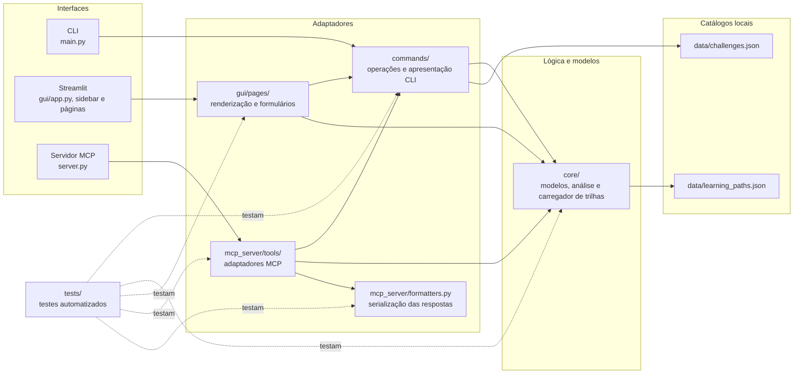

# Arquitetura do Geo-Explorer

Este documento descreve a arquitetura efetivamente implementada no
Geo-Explorer: uma aplicação Python com interfaces CLI e Streamlit, além de um
servidor MCP por stdio. A documentação não pressupõe serviços externos,
bancos de dados ou execução de modelos de IA.

O [README](../README.md) apresenta instalação e execução. O
[índice da documentação](index.md) resume as interfaces e os diretórios do
projeto.

## Visão geral

As três interfaces adaptam as mesmas capacidades de aprendizagem a diferentes
formas de uso:

- a CLI recebe escolhas e dados por prompts e apresenta texto no terminal;
- o Streamlit renderiza páginas, formulários e resultados;
- o servidor MCP registra quatro ferramentas para chamadas de um cliente
  compatível.

As interfaces reutilizam funções de [commands/](../commands/) e
[core/](../core/), mas não há uma camada de serviço única que encapsule todos
os casos. A lógica de carregamento e filtragem de desafios, por exemplo, está
em `commands/desafio.py`; o carregamento de trilhas está em
`core/data_loader.py`. Os dois catálogos são arquivos JSON locais.

## Fluxo entre interfaces, camadas e dados

O diagrama representa dependências usadas pelas funcionalidades, não uma regra
de que todo módulo de uma camada chama todos os módulos da camada seguinte.
`gui/app.py` usa
[gui/components/sidebar.py](../gui/components/sidebar.py) para navegar e
despachar a página ativa. As páginas fazem chamadas conforme a funcionalidade:
por exemplo, Trilhas carrega dados por `core/`, enquanto Desafio e Certificado
reutilizam funções de `commands/`.

## Responsabilidades das camadas

### `commands/`

Contém funções de operações e apresentação usadas pela CLI e, em alguns casos,
reutilizadas pela GUI e pelo MCP:

- [trilha.py](../commands/trilha.py) procura uma trilha por tecnologia e
  formata seus dados para o terminal;
- [desafio.py](../commands/desafio.py) carrega e valida os desafios, filtra
  por tecnologia e nível e pode selecionar um resultado aleatoriamente;
- [certificado.py](../commands/certificado.py) constrói os dados do
  certificado e apresenta sua versão textual;
- [analise.py](../commands/analise.py) converte o perfil recebido, chama a
  análise de `core/` e formata o resultado para o terminal.

Essa camada não é estritamente composta apenas de adaptadores finos: o
carregamento e o filtro do catálogo de desafios também estão implementados em
`commands/desafio.py`.

### `core/`

Contém os modelos compartilhados, a análise de competências e o carregador de
trilhas:

- [models.py](../core/models.py) define `Level`, `RecommendationType` e as
  dataclasses de trilhas, etapas, perfis, desafios, recomendações e análises;
- [competency_analyzer.py](../core/competency_analyzer.py) compara o perfil
  informado com as trilhas e constrói recomendações;
- [data_loader.py](../core/data_loader.py) lê `data/learning_paths.json` e
  converte os registros em modelos de domínio.

`core/` não é totalmente livre de I/O: `data_loader.py` lê um arquivo JSON.

### `gui/`

Contém a entrada do Streamlit, a navegação lateral personalizada e as páginas.
[app.py](../gui/app.py) configura a aplicação, chama
[sidebar.py](../gui/components/sidebar.py) e escolhe qual função `render()`
executar. A sidebar mantém `current_page` em `st.session_state`; os CTAs da
Home também atualizam essa chave e solicitam uma nova execução da aplicação.

As páginas chamam a lógica existente conforme necessário:

- [trilhas.py](../gui/pages/trilhas.py) carrega trilhas por `core/`;
- [desafio.py](../gui/pages/desafio.py) usa carregamento e filtro de
  `commands/desafio.py`, e deixa a pessoa selecionar um desafio compatível;
- [certificado.py](../gui/pages/certificado.py) chama
  `commands.certificado.build_certificate`;
- [analise.py](../gui/pages/analise.py) carrega trilhas e desafios e chama
  `core.competency_analyzer.analyze_profile`;
- [home.py](../gui/pages/home.py) apresenta o produto e oferece CTAs para
  navegar às outras páginas.

O perfil e os resultados da análise, o desafio selecionado e o certificado
gerado são mantidos em chaves explícitas de `st.session_state`. Não há banco
de dados nem persistência entre sessões.

### `mcp_server/`

[server.py](../mcp_server/server.py) cria um `MCPServer`, registra as
ferramentas de [tools/](../mcp_server/tools/) e inicia `mcp.run()` com o
transporte stdio padrão. A saída padrão fica reservada ao protocolo; o código
usa logging para diagnóstico.

As ferramentas adaptam funções de `commands/` e `core/` para chamadas MCP:

| Ferramenta | Operação |
|---|---|
| `get_learning_path` | Procura uma trilha por tecnologia e retorna sua representação estruturada. |
| `get_challenge` | Filtra desafios por tecnologia e nível e escolhe um resultado aleatoriamente. |
| `generate_certificate` | Constrói e retorna os dados de um certificado fictício. |
| `analyze_competencies` | Cria o perfil recebido, executa a análise e retorna análises estruturadas. |

[formatters.py](../mcp_server/formatters.py) converte os resultados para
estruturas serializáveis, incluindo níveis e datas. O servidor registra
ferramentas; não registra recursos MCP nem disponibiliza endpoint HTTP.

### `data/`

Contém dois catálogos JSON locais e estáticos:

- [learning_paths.json](../data/learning_paths.json): trilhas, competências
  agregadas e etapas;
- [challenges.json](../data/challenges.json): desafios, critérios de
  avaliação, competências avaliadas e tempo estimado.

As descrições podem citar bibliotecas, serviços ou tecnologias como parte de
um exercício. Essas menções não indicam que o Geo-Explorer tenha implementado
ou instalado tais integrações.

## Fluxo de execução por interface

### CLI

1. [main.py](../main.py) apresenta um menu interativo e recebe a opção por
   entrada padrão.
2. A opção selecionada chama a função correspondente de `commands/`:
   consulta de trilha, geração de desafio, geração de certificado ou análise
   de competências.
3. As funções carregam os dados necessários, reutilizam modelos e regras de
   `core/` quando aplicável e imprimem o resultado no terminal.
4. A opção de saída encerra o menu. A entrada de nível é validada contra os
   valores do enum `Level`.

### Streamlit

1. `gui/app.py` chama `st.set_page_config()` e renderiza a sidebar.
2. A sidebar inicializa `current_page` como `home` quando a chave ainda não
   existe, e os botões atualizam a página ativa. Os CTAs da Home também mudam
   essa chave e chamam `st.rerun()`.
3. A aplicação despacha a execução para a função `render()` da página
   selecionada.
4. A página chama loaders e funções de domínio apropriados, exibe os
   resultados e trata as entradas e erros esperados.
5. Resultados que precisam permanecer após outra navegação são armazenados em
   `st.session_state`; não são gravados em armazenamento persistente.

### MCP

1. `python -m mcp_server.server` chama `create_server()`.
2. `create_server()` cria o servidor e registra as quatro ferramentas por
   meio de `register_all_tools()`.
3. `main()` inicia `mcp.run()` usando stdio; um cliente MCP compatível inicia e
   comunica-se com esse processo.
4. A ferramenta valida seus parâmetros, chama os loaders e regras
   correspondentes, e os formatters transformam o resultado em dados
   serializáveis.
5. As respostas são devolvidas ao cliente MCP; o servidor não inicia uma API
   HTTP.

## Modelos e análise de competências

Os modelos em `core/models.py` formam o vocabulário de domínio:

- `LearningPath` e `LearningStep` representam trilhas e etapas;
- `LearnerProfile` representa um perfil informado para análise;
- `Challenge` representa os metadados de um desafio;
- `Recommendation` registra um próximo passo sugerido;
- `CompetencyAnalysis` reúne a comparação entre um perfil e uma trilha;
- `Level` e `RecommendationType` são enums usados pelas operações.

`analyze_profile()` filtra as trilhas pelas tecnologias de interesse; se a
lista de interesse estiver vazia, considera todas as trilhas fornecidas. A
comparação normaliza as competências removendo espaços externos e ignorando
diferenças entre maiúsculas e minúsculas. O resultado separa competências
correspondentes, ausentes e extras, e calcula o índice como a proporção de
competências da trilha que também foram informadas no perfil.

Para cada competência ausente, o analisador constrói uma recomendação. A
prioridade considera quantas etapas da trilha desenvolvem a competência e
quantos desafios da mesma tecnologia a avaliam. Quando há desafios associados
sem uma etapa correspondente, a escolha de alvo considera a proximidade entre
o nível do perfil e o nível do desafio. As recomendações são ordenadas por
prioridade decrescente, posição da primeira etapa e nome da competência.

Esse cálculo organiza as declarações fornecidas; não verifica a proficiência
por provas ou evidências práticas.

## Carregamento e validação dos catálogos

### Trilhas

`core/data_loader.py` resolve o caminho do catálogo a partir da localização do
projeto, abre `data/learning_paths.json` em UTF-8, exige uma lista no nível
superior e converte os itens para `LearningPath` e `LearningStep`. O loader
verifica campos obrigatórios, os tipos de listas e o nível informado, que deve
corresponder a um valor de `Level`.

Quando o arquivo não pode ser encontrado ou lido, ou o JSON ou sua estrutura
são inválidos, o código lança `FileNotFoundError`, `OSError` ou `ValueError`,
conforme o caso. A documentação no docstring de `load_learning_paths()`
menciona `SystemExit`, o que diverge das exceções efetivamente lançadas.

### Desafios

`commands/desafio.py` também resolve o caminho a partir do projeto e lê
`data/challenges.json` em UTF-8. Exige uma lista no nível superior e valida os
campos obrigatórios, as listas de critérios e competências e o valor de nível.
`estimated_hours` é opcional. Os registros válidos são convertidos em objetos
`Challenge`.

Assim, os carregadores têm responsabilidades em módulos diferentes: trilhas
são carregadas por `core/data_loader.py`, enquanto desafios são carregados e
filtrados por `commands/desafio.py`. A GUI e o MCP apresentam mensagens ou
objetos de erro de acordo com cada interface; eles não tornam os arquivos
editáveis.

## Testes e relação com as camadas

Os testes ficam em [tests/](../tests/) e usam pytest, `unittest` e o `AppTest`
do Streamlit, conforme o tipo de fluxo:

- `test_data_loader.py` cobre carregamento, conversão e erros do catálogo de
  trilhas;
- `test_desafio.py` e `test_trilha.py` cobrem operações e apresentação dos
  comandos correspondentes;
- `test_competency_analyzer.py` e `test_analise.py` cobrem análise e
  apresentação de competências;
- `test_certificado.py` cobre criação e apresentação de certificados;
- `test_mcp_tools.py` cobre formatters, ferramentas e chamadas pelo protocolo;
- `test_gui_*.py` usa `AppTest` para Home, Trilhas, Desafio, Certificado e
  Análise.

Os testes usam os catálogos locais e mocks para simular erros. A integração
MCP usa `Client(create_server())` em processo e não abre stdio; portanto, ela
não substitui um teste de inicialização em um cliente MCP externo. Também não
há um teste dedicado ao fluxo completo do menu interativo de `main.py`.

## Limitações arquiteturais

- **Dados locais e estáticos:** os catálogos são os arquivos JSON fornecidos
  com o projeto; não há serviço de catálogo nem edição pela interface.
- **Sem banco ou persistência de perfil:** dados do perfil e alguns resultados
  ficam apenas na sessão Streamlit.
- **Competências autodeclaradas:** o índice e as recomendações refletem os
  dados informados, sem verificação por evidências práticas.
- **Desafios não executados:** a aplicação apresenta descrições e critérios,
  mas não executa soluções nem atribui resultados automaticamente.
- **Certificados fictícios:** são registros de apresentação, sem validade
  oficial e sem exportação.
- **Sem modelos ou agentes de IA:** as ferramentas MCP permitem que um cliente
  invoque funcionalidades do projeto; não implementam nem executam agentes ou
  modelos.
- **MCP via stdio:** não há transporte HTTP ou recursos MCP registrados.
