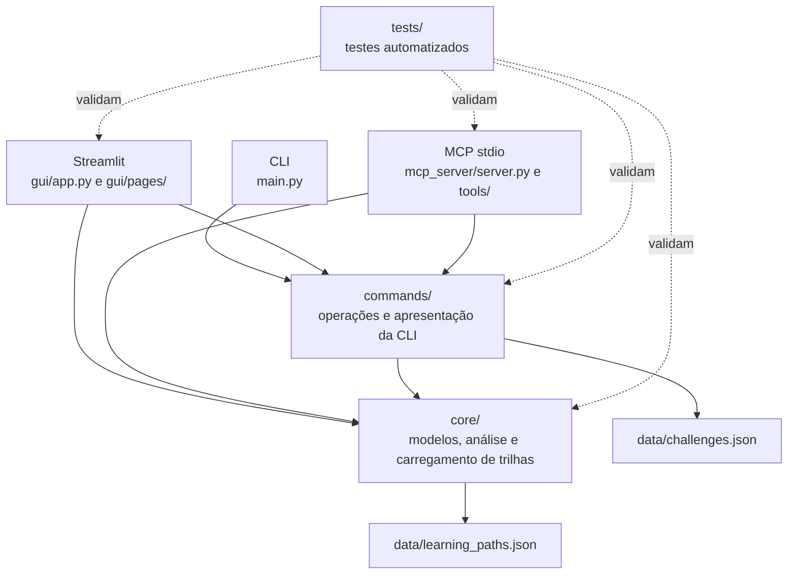

# Documentação técnica do Geo-Explorer

Este índice apresenta a documentação técnica do Geo-Explorer e organiza os
materiais de referência do projeto. Consulte também o [README principal](../README.md)
para instalação, execução, funcionalidades e avisos de uso.

## Objetivo e público-alvo

O Geo-Explorer organiza catálogos locais de trilhas de aprendizagem e desafios
práticos e compara esses conteúdos com as competências informadas pela pessoa
usuária. Destina-se principalmente a pessoas em aprendizagem autodirigida e a
quem deseja estudar ou explorar um projeto Python com interfaces CLI,
Streamlit e MCP.

As análises refletem competências autodeclaradas; não verificam domínio por
evidências práticas. O projeto oferece ferramentas MCP, mas não executa
agentes nem modelos de IA. Os certificados gerados são fictícios e não têm
validade oficial ou exportação. Os desafios são descrições de exercícios:
não são executados nem avaliados automaticamente. Os catálogos são arquivos
JSON locais e estáticos, sem integração com a DIO. Não há banco de dados nem
persistência permanente de perfis; os dados da interface Streamlit são
mantidos somente na sessão.

## Visão geral das interfaces

- **CLI:** menu interativo iniciado por `main.py`, com operações para consultar
  trilhas, gerar desafios e certificados fictícios e analisar competências.
- **Streamlit:** interface gráfica com páginas de Home, Trilhas, Desafio
  Prático, Certificado e Análise de Competências.
- **MCP:** servidor iniciado por `mcp_server.server`, com quatro ferramentas e
  transporte stdio para comunicação com um cliente MCP compatível. Não há
  endpoint HTTP nem recursos MCP registrados, e o servidor não executa
  modelos ou agentes.

## Mapa visual da arquitetura

Os catálogos são arquivos JSON locais e estáticos, sem integração com a DIO.
O diagrama mostra as responsabilidades principais: o carregador de trilhas
está em `core/`, e o carregamento e filtro de desafios estão em `commands/`.
As competências analisadas são autodeclaradas, sem validação prática; os
certificados são fictícios e não têm validade oficial ou exportação. O projeto
não executa desafios, modelos ou agentes de IA.

## Diretórios e responsabilidades

| Diretório ou arquivo | Responsabilidade |
|---|---|
| [`core/`](../core/) | Modelos de domínio, análise de competências e carregamento das trilhas. |
| [`commands/`](../commands/) | Operações compartilhadas pelas interfaces e apresentação da CLI; inclui carregamento e filtro de desafios. |
| [`gui/`](../gui/) | Aplicação Streamlit, navegação lateral e páginas. |
| [`mcp_server/`](../mcp_server/) | Inicialização do servidor stdio, ferramentas MCP e formatação dos resultados. |
| [`data/`](../data/) | Catálogos locais de trilhas e desafios em JSON. |
| [`tests/`](../tests/) | Testes de modelos, dados, regras, comandos, ferramentas MCP e interface. |
| [`docs/`](./) | Índice e documentos técnicos de arquitetura, MCP, exemplos e testes. |
| [`.streamlit/config.toml`](../.streamlit/config.toml) | Configuração visual e de navegação do Streamlit. |
| [`main.py`](../main.py) | Ponto de entrada do menu CLI. |
| [`requirements.txt`](../requirements.txt) | Faixas de versão das dependências declaradas. |

## Documentação disponível

| Documento | Conteúdo |
|---|---|
| [README principal](../README.md) | Apresentação, instalação, execução, dados, estrutura do projeto e limitações. |
| [Índice da documentação](index.md) | Este índice, visão geral das interfaces e mapa visual da arquitetura. |
| [Arquitetura](architecture.md) | Camadas, responsabilidades, fluxos, modelos, catálogos, testes e limitações arquiteturais. |
| [Integração MCP](mcp.md) | Inicialização stdio, quatro ferramentas, parâmetros, retornos, exemplos e limitações. |
| [Exemplos práticos](examples.md) | Exemplos CLI, Streamlit e MCP baseados na implementação e nos catálogos locais. |
| [Testes](testing.md) | Preparação, comandos, organização, cobertura observada, limitações e resultado histórico registrado. |
